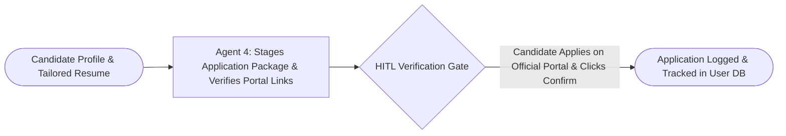

# CareerPilot 🚀
### Autonomous Multi-Agent Job-Readiness & Application Copilot for Graduating Engineers

[](https://www.python.org/downloads/)
[](https://fastapi.tiangolo.com)
[](https://www.mongodb.com/)
[](https://tailwindcss.com/)
[-6366F1.svg)](./SYSTEM_DESIGN.md)
[](https://careerpilot-ai-dqfw.onrender.com)

> **🌐 Official Live Deployment:** [https://careerpilot-ai-dqfw.onrender.com](https://careerpilot-ai-dqfw.onrender.com)

---

## 🌟 Overview & Key Differentiators

**CareerPilot** is an end-to-end, stateful multi-agent AI copilot engineered specifically to combat graduate hiring anxiety and eliminate unguided "spray-and-pray" job applications.

Rather than relying on ungrounded text generation or dangerous auto-submit scripts, CareerPilot executes an orchestrated 5-agent pipeline grounded in verified candidate data and real employer job descriptions:

1. **Assessment Agent** — Parses PDF resumes, concurrently queries public GitHub & LeetCode APIs, builds verified developer skill vectors, and benchmarks alignment against real tech job descriptions.
2. **Gap & Learning Agent** — Ranks missing skills by empirical market frequency across targeted postings and synthesizes a structured 14-day study roadmap mapped to free, verified educational resources (NPTEL, YouTube full courses, official documentation).
3. **Tailoring Agent** — Contextualizes candidate achievements into high-impact **STAR format** (Situation, Task, Action, Result) bullet points and custom 3-paragraph cover letters with strict anti-hallucination guardrails that forbid inventing unverified credentials.
4. **Application Staging & Verification Agent** — Packages pre-filled application review cards, generates 1-click clipboard quick-apply bundles, verifies official employer career portal endpoints (Razorpay, Swiggy, TCS, etc.), and enforces an ethical **Human-in-the-Loop (HITL)** checkpoint before recording applications in the tracker database.
5. **Interview Prep Agent** — Generates role-specific technical and behavioral questions from the target JD and conducts interactive mock interviews with dual-score evaluation (1–10 on technical depth, 1–10 on STAR communication) and senior engineer model answers.

---

## 🛡️ The Human-in-the-Loop (HITL) Gate: Why Auto-Submit Bots Fail



Fully autonomous auto-submit scripts violate the Terms of Service (ToS) of major portals (LinkedIn, Naukri), frequently triggering CAPTCHA blocks, IP restrictions, and permanent account suspensions. CareerPilot’s **assistive staging with an explicit human confirmation gate** is an intentional architectural decision:
* **100% Platform Compliant**: Automation assists with structured data preparation and link verification; the final submission action remains human-driven.
* **Zero Liability**: Eliminates risks of LLM misfiling, hallucinated visa disclosures, or incorrect personal submissions.
* **Responsible AI Engineering**: Demonstrates ethical supervisory control and transparent candidate tracking.

---

## 🛠️ Technology Stack

| Layer | Component | Implementation Details |
| :--- | :--- | :--- |
| **Backend & API** | FastAPI (Python 3.10+) | Asynchronous REST endpoints, automatic OpenAPI documentation, modular router architecture |
| **Multi-Agent Orchestration** | Pipeline Orchestrator | Centralized, typed state machine coordinating data handoffs across the 5 agents |
| **Database & Persistence** | MongoDB (Motor Async) + Local Fallback | Primary async MongoDB connection with seamless local JSON document store fallback (`data/local_db.json`) |
| **LLM Inference** | Google Gemini 1.5 Flash / Groq Llama-3.1-70B | Fast token generation with graceful deterministic heuristic fallback when API keys are absent |
| **Information Retrieval & NLP** | TF-IDF + Cosine Similarity & Skill Overlap | Fast local sparse vectorization and keyword matching without paid vector database overhead |
| **Document Parsing** | `pdfplumber` & `pypdf` | Layout-aware text and section extraction from candidate resume PDFs |
| **Frontend UI** | FastAPI + Jinja2 + Tailwind CSS SPA | Modern responsive single-page architecture, 5-tab stepper, dynamic auth modals, printable resume view |
| **Security & Auth** | SHA-256 Authentication Gate | Immediate modal on entry (Login / Register / Guest Mode) with save enforcement for guest profiles |
| **Hosting & Deployment** | Render Cloud Platform | Automatic deployment via Git, Procfile, and render.yaml |

---

## 🚀 Quickstart & Local Setup

### 1. Clone the repository
```bash
git clone https://github.com/anvitha-45/careerpilot.git
cd careerpilot
```

### 2. Create and activate a virtual environment
```bash
python -m venv venv
# Windows (PowerShell):
.\venv\Scripts\Activate.ps1
# Linux/macOS:
source venv/bin/activate
```

### 3. Install dependencies
```bash
pip install -r requirements.txt
```

### 4. Configure environment variables (Optional)
Copy `.env.example` to `.env`:
```bash
cp .env.example .env
```
*(CareerPilot runs out-of-the-box even without external API keys using deterministic local heuristic fallbacks).*

### 5. Run the server
```bash
python main.py
```
Open your browser at **`http://localhost:8000`** to access the responsive dashboard.

---

## 🧪 Running Tests

CareerPilot includes an automated test suite verifying all 5 agents, the HITL gate, authentication, and custom job ingestion:

```bash
# End-to-end 5-Agent Pipeline & HITL Gate
python tests/test_pipeline.py

# Authentication Gate & Save Enforcement
python tests/test_auth.py

# Custom Job URL & Text Ingestion
python tests/test_custom_job.py

# Resume Text & Contact Extraction
python tests/test_resume_extraction.py
```

---

## ☁️ Deployment on Render

CareerPilot is deployed on **Render** under the **`careerpilot-ai`** service at **[https://careerpilot-ai-dqfw.onrender.com](https://careerpilot-ai-dqfw.onrender.com)**:
1. Connect your GitHub repository to [Render](https://render.com) (`careerpilot-ai` service).
2. Create a new **Web Service**.
3. Render automatically reads `render.yaml` or `Procfile`:
   * **Build Command**: `pip install -r requirements.txt`
   * **Start Command**: `uvicorn server.main:app --host 0.0.0.0 --port $PORT`
4. Optional Environment Variables in your Render Dashboard:
   * `MONGODB_URI`: Your MongoDB Atlas connection string (falls back to local document store if omitted).
   * `GEMINI_API_KEY`: Google AI Studio API key.
   * `GROQ_API_KEY`: Groq Cloud API key.
   * `ENABLE_PLAYWRIGHT`: `false` (default: false for maximum cloud stability).

---

## 📂 Project Structure

```text
careerpilot/
├── PRD.md                         # Product Requirements Document
├── SYSTEM_DESIGN.md               # Detailed System Architecture & Viva Guide
├── README.md                      # Project documentation
├── careerpilot_architecture.drawio# Architecture diagram (Draw.io format)
├── careerpilot_architecture.xml   # XML version of Draw.io diagram
├── docs/
│   └── careerpilot_architecture.drawio
├── requirements.txt               # Pinned dependencies
├── Procfile                       # Render deployment declaration
├── render.yaml                    # Render blueprint
├── main.py                        # Root server entrypoint (Uvicorn runner)
├── data/
│   ├── sample_jds.json            # Curated Indian tech job descriptions (22 roles)
│   ├── curated_resources.json     # Curated free learning resources (NPTEL, YouTube, Docs)
│   └── local_db.json              # Resilient local JSON document store (fallback)
├── server/
│   ├── config.py                  # Pydantic settings & environment configuration
│   ├── database.py                # Async MongoDB manager with embedded document store fallback
│   ├── main.py                    # FastAPI application, CORS, lifespan, and template routes
│   ├── agents/
│   │   ├── state.py               # Central TypedDict state schema (CareerPilotState)
│   │   ├── assessment_agent.py    # Agent 1: Resume parsing & GitHub/LeetCode benchmarking
│   │   ├── gap_learning_agent.py  # Agent 2: Empirical skill gap analysis & 14-day roadmap
│   │   ├── tailoring_agent.py     # Agent 3: STAR bullet rewriter & custom cover letter
│   │   ├── application_agent.py   # Agent 4: Application staging, portal verification & HITL gate
│   │   ├── interview_agent.py     # Agent 5: Dynamic mock interview Q&A & dual scoring
│   │   └── orchestrator.py        # Central Pipeline Orchestrator coordinating all 5 agents
│   ├── routers/
│   │   └── api.py                 # REST API endpoints (Auth, Assess, Tailor, Staging, Mock)
│   ├── seeds/
│   │   └── seed_data.py           # Initial job description seed loader
│   ├── templates/
│   │   └── index.html             # Responsive Tailwind SPA dashboard (5-tab workflow)
│   └── utils/
│       ├── resume_parser.py       # PDF layout-aware text parser & entity extractor
│       ├── job_extractor.py       # Custom job posting scraper & text parser
│       ├── github_client.py       # GitHub REST client for public profile statistics
│       ├── leetcode_client.py     # LeetCode GraphQL client for problem-solving stats
│       └── similarity.py          # TF-IDF Cosine semantic similarity & weighted readiness
└── tests/
    ├── test_pipeline.py           # End-to-end 5-agent pipeline & HITL verification
    ├── test_auth.py               # Authentication gate & guest save enforcement tests
    ├── test_custom_job.py         # Custom job ingestion & dynamic benchmark tests
    └── test_resume_extraction.py  # Resume text & contact parsing unit tests
```

---

## 📜 License
MIT License. Built for engineering students and responsible AI research.
