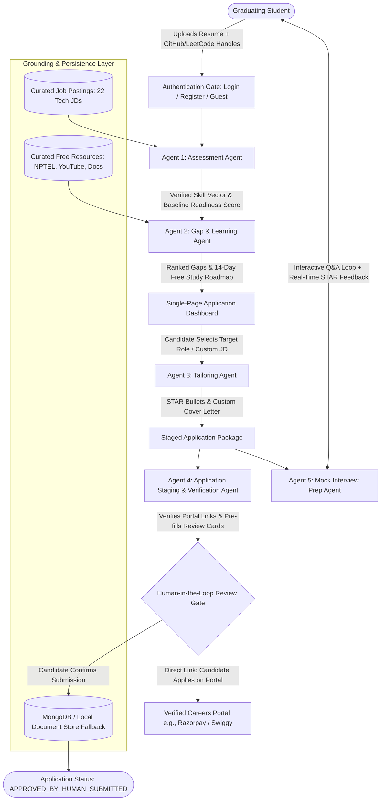
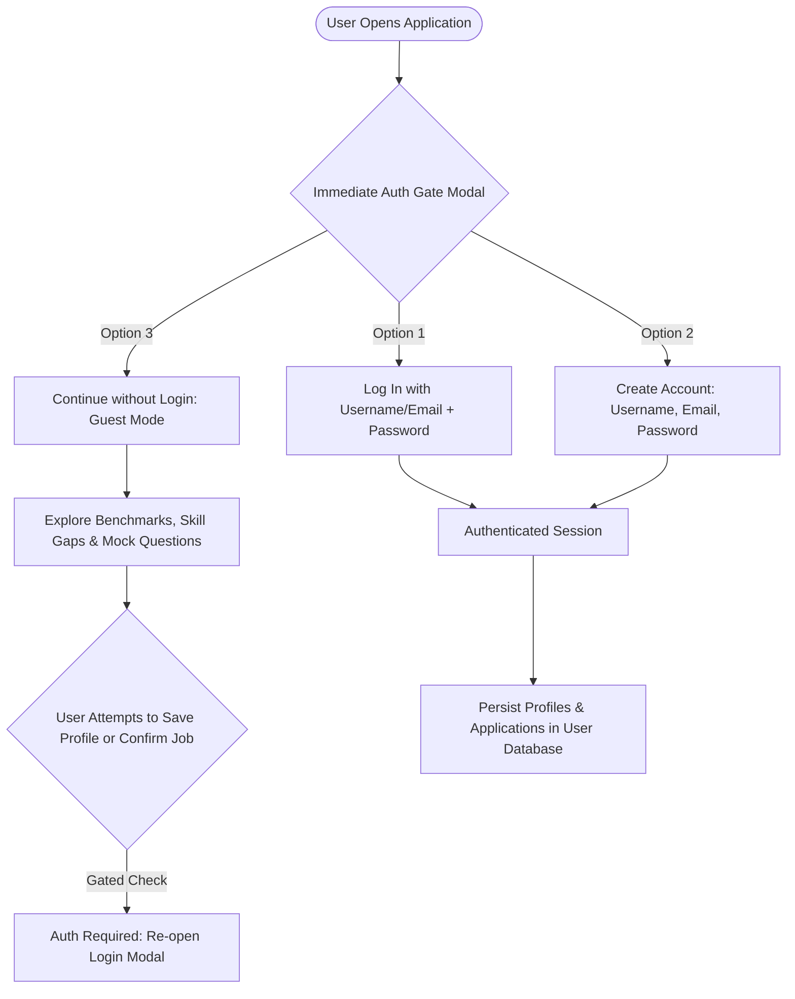

# CareerPilot: System Design, Architecture & Implementation Specification

---

## 1. Executive Summary & Vision

**CareerPilot** is an end-to-end, stateful multi-agent AI copilot designed specifically for graduating engineering students. Rather than operating as an ungrounded resume generator or a brittle auto-apply script, CareerPilot coordinates a 5-agent pipeline that guides a candidate through the complete career readiness journey:

1. **Self-Assessment & Profiling** — Parses resume artifacts and validates live coding profiles via GitHub REST and LeetCode GraphQL APIs.
2. **Empirical Gap Analysis & Free Learning** — Computes frequency-ranked skill gaps across real job postings and maps them to curated free educational resources (NPTEL, YouTube, official documentation) in a structured 14-day study roadmap.
3. **Context-Aware Application Tailoring** — Transforms authentic candidate project achievements into STAR-format (Situation, Task, Action, Result) bullet points and custom 3-paragraph cover letters with strict anti-hallucination constraints.
4. **Application Staging & Human-in-the-Loop (HITL) Gate** — Pre-fills application review cards, generates 1-click clipboard quick-apply bundles, verifies employer portal links, and enforces a mandatory human confirmation checkpoint before recording the application in the tracker database.
5. **Interactive Mock Interview Preparation** — Generates domain-grounded technical and behavioral questions from the targeted JD and evaluates responses using a dual-score rubric (Technical Depth 1–10 and Communication/STAR 1–10) with senior engineer model answers.

### The Core Architectural Principle: Ethical Human-in-the-Loop (HITL) Gate
Unlike fragile auto-apply bots that violate the Terms of Service (ToS) of major hiring platforms (LinkedIn, Naukri) and risk permanent account bans, CareerPilot structures candidate data into staging packages and **halts execution at a review-and-confirm checkpoint (`STAGED_AWAITING_APPROVAL`)**. The candidate validates the pre-filled inputs, accesses the verified employer portal, applies directly, and explicitly confirms submission. This transforms a risky bot into a compliant, ethical, and responsible AI productivity tool.

---

## 2. Multi-Agent Pipeline & State Architecture

The CareerPilot system coordinates agent transitions through a centralized, asynchronous `PipelineOrchestrator` (`server/agents/orchestrator.py`) maintaining a strongly-typed state schema (`server/agents/state.py`).



### Central State Schema (`server/agents/state.py`)

```python
from typing import TypedDict, List, Dict, Any, Optional

class CareerPilotState(TypedDict):
    # Candidate Baseline Data
    candidate_id: str
    raw_resume_text: str
    parsed_skills: List[str]
    candidate_name: str
    candidate_email: str
    candidate_phone: str
    github_handle: Optional[str]
    github_stats: Dict[str, Any]
    leetcode_handle: Optional[str]
    leetcode_stats: Dict[str, Any]
    target_domain: str
    overall_readiness_score: float

    # Market Intelligence & Gap Analysis
    target_jds: List[Dict[str, Any]]
    ranked_skill_gaps: List[Dict[str, Any]]
    learning_recommendations: List[Dict[str, Any]]

    # Job Tailoring Artifacts
    active_jd: Dict[str, Any]
    tailored_resume_bullets: List[Dict[str, Any]]
    tailored_cover_letter: str

    # Application Staging & HITL
    staging_portal_url: str
    staging_status: str  # "IDLE" | "STAGED_AWAITING_APPROVAL" | "APPROVED_BY_HUMAN_SUBMITTED"
    staged_payload: Dict[str, Any]

    # Interview Preparation Loop
    mock_questions: List[Dict[str, Any]]
    mock_evaluations: List[Dict[str, Any]]
```

---

## 3. Deep-Dive: The 5 Autonomous Agent Modules

### Module 1: Candidate Assessment Agent (`server/agents/assessment_agent.py`)
* **Purpose**: Parse raw resume artifacts, validate developer activity from public APIs, and benchmark technical readiness against real tech job postings.
* **Component Pipeline**:
  1. **Resume Parser (`server/utils/resume_parser.py`)**: Uses `pdfplumber` and `pypdf` with layout-aware regex heuristics to extract candidate name, email, phone number, GitHub/LeetCode/LinkedIn links, listed skills, and project summaries.
  2. **GitHub Signal Extractor (`server/utils/github_client.py`)**: Asynchronously queries the public GitHub REST API (`https://api.github.com/users/{username}/repos`) to aggregate public repository counts, total star counts, and top programming languages.
  3. **LeetCode Signal Extractor (`server/utils/leetcode_client.py`)**: Asynchronously queries the public LeetCode GraphQL API (`https://leetcode.com/graphql`) to extract total solved problem counts partitioned into `Easy`, `Medium`, and `Hard`.
  4. **Multi-Source Skill Normalization**: Merges extracted resume skills with languages verified on GitHub into a unified skill set.
  5. **Weighted Readiness Scoring Engine (`server/utils/similarity.py`)**:
     * Calculates candidate readiness against target JDs using a weighted formula:
       $$\text{Readiness Score} = (0.50 \times \text{Skill Overlap}) + (0.10 \times \text{Preferred Skill Overlap}) + (0.20 \times \text{TF-IDF Cosine Similarity}) + (0.12 \times \text{LeetCode Signal}) + (0.08 \times \text{GitHub Signal})$$
     * Bounded between 15.0% and 96.0% to reflect realistic engineering preparedness.
* **Persistence**: Upserts the full candidate profile into the `profiles` collection in MongoDB / local document store.

---

### Module 2: Market Benchmarking & Gap Learning Agent (`server/agents/gap_learning_agent.py`)
* **Purpose**: Eliminate student uncertainty by ranking missing skills by actual market demand frequency and providing free, curated learning resources.
* **Component Pipeline**:
  1. **Empirical Frequency Aggregator**:
     * Scans all job descriptions matching the candidate's chosen domain (Backend, Full Stack, Frontend, Cloud/DevOps, Data/AI).
     * Calculates the exact occurrence frequency of every required and preferred skill.
  2. **Set-Difference & Market Demand Percentage**:
     * Determines missing skills: $\text{Missing Skills} = \text{JD Skills} - \text{Candidate Verified Skills}$.
     * Computes the market demand percentage: $\frac{\text{Postings Requiring Skill}}{\text{Total Domain Postings}} \times 100$.
     * Categorizes priority into **Critical** ($\ge 60\%$), **High** ($\ge 40\%$), or **Recommended** ($< 40\%$).
  3. **Curated Free Resource Mapping (`data/curated_resources.json`)**:
     * Maps each missing skill to verified free educational resources:
       * **NPTEL / SWAYAM**: Rigorous academic foundations (Operating Systems, DBMS, Computer Networks).
       * **YouTube Full Courses**: Practical modern stacks (freeCodeCamp, Traversy Media, TechWorld with Nana).
       * **Official Documentation**: Authoritative quickstarts and reference guides.
  4. **14-Day Micro-Learning Roadmap Generator**:
     * Organizes the top 4 missing skills into sequential 3-day milestone sprints with actionable project goals and direct URLs.
* **Persistence**: Stores gap analyses and customized study roadmaps into the `learning` collection.

---

### Module 3: Context-Aware Resume Tailoring Agent (`server/agents/tailoring_agent.py`)
* **Purpose**: Contextualize candidate project bullets for a specific target job without fabricating unearned experience.
* **Component Pipeline**:
  1. **JD Semantic Parsing**: Extracts core responsibilities, tech stack, and evaluation criteria for the selected role.
  2. **STAR-Format Project Rewriter**:
     * Rephrases the candidate's genuine project descriptions into structured **Situation, Task, Action, Result** bullet points.
     * Incorporates relevant tools from the target JD while remaining grounded in candidate capabilities.
  3. **Strict Anti-Hallucination Guardrail**:
     ```text
     STRICT SAFETY RULE: You are strictly forbidden from inventing tools, false job titles,
     or fictional metrics. Rephrase genuine achievements using the STAR methodology
     (Situation, Task, Action, Result) with strong action verbs. Highlight alignment with the target role.
     ```
  4. **Graceful Deterministic Heuristic Fallback**:
     * If external LLM API keys (Gemini / Groq) are unavailable or rate-limited, the agent falls back to hand-crafted, domain-specific STAR bullet generators and cover letter templates, ensuring 100% demo reliability.
  5. **Custom 3-Paragraph Cover Letter Generator**:
     * Drafts a professional cover letter highlighting the candidate's verified skills, academic projects, and motivation for the target company.
* **Persistence**: Saves tailored materials to the `applications` collection with status `STAGED_AWAITING_APPROVAL`.

---

### Module 4: Application Staging & Verification Agent (`server/agents/application_agent.py`)
* **Purpose**: Structure application materials, package quick-apply clipboard data, verify employer portal links, and enforce ethical human-supervised submission.
* **Component Pipeline**:
  1. **Application Review Card Pre-filling**:
     * Compiles structured fields: Applicant Name, Email, Phone, Target Role, Company, GitHub, LinkedIn, Work Authorization, Notice Period, Tailored Resume file name, and Cover Letter status.
  2. **Portal URL Verification**:
     * Resolves verified official careers portal endpoints (e.g. Razorpay, Swiggy, TCS) and generates direct LinkedIn job search URLs.
  3. **1-Click Clipboard Quick-Apply Bundle**:
     * Packages tailored cover letters and candidate links for rapid copying during manual form completion.
  4. **The Human-in-the-Loop (HITL) Checkpoint**:
     * Sets application state to `STAGED_AWAITING_APPROVAL`.
     * Does NOT inject automated keystrokes into live third-party portals, avoiding CAPTCHA triggers and platform bans.
     * Displays compliance notice: *"Compliant with LinkedIn & Naukri Terms of Service. No automated submission occurred. Final application dispatch requires explicit human confirmation."*
  5. **Human Confirmation & Application Tracker**:
     * When the user clicks "Confirm & Log Application" (`POST /api/applications/confirm`), the status transitions to `APPROVED_BY_HUMAN_SUBMITTED` with a UTC timestamp and is logged in the user's application tracker database.
  6. **Optional Sandbox Playwright Runner**:
     * Controlled by `ENABLE_PLAYWRIGHT=true` (default: false for cloud deployment stability), allowing headless browser sandbox runs when explicitly enabled.

---

### Module 5: Mock Interview Preparation Agent (`server/agents/interview_agent.py`)
* **Purpose**: Transform target job requirements and candidate gaps into dynamic, role-specific technical and behavioral mock interview sessions.
* **Component Pipeline**:
  1. **Dynamic Question Synthesis**:
     * Generates 5 authentic questions:
       * **Technical Deep-Dive**: Project-grounded questions testing architecture and runtime behavior.
       * **System & Data Architecture**: Realistic problem-solving questions testing latency, indexing, and scaling.
       * **Behavioral (STAR)**: Scenario-based questions assessing teamwork, engineering trade-offs, and communication.
  2. **Evaluation & Dual Scoring Rubric**:
     * Evaluates written candidate answers across two 10-point dimensions:
       * **Technical Accuracy & Depth (1–10)**: Rewarding mention of concrete tools, protocols, indexes, caches, and quantified metrics.
       * **Communication & STAR Alignment (1–10)**: Evaluating structured storytelling (Situation, Task, Action, Result).
       * **Overall Score**: $( \text{Technical} + \text{Communication} ) / 2$.
  3. **Constructive Critique & Senior Engineer Model Answer**:
     * Highlights missing technical concepts, trade-offs, and metrics.
     * Provides an exemplary 3-4 sentence Senior Engineer Model Answer demonstrating the ideal STAR structure.

---

## 4. Custom Job Posting Ingestion Engine (`server/utils/job_extractor.py`)

To ensure candidates are not restricted to pre-seeded job postings, CareerPilot includes an asynchronous custom job ingestion engine:

1. **Dual Ingestion Paths**:
   * **URL Ingestion**: Fetches live web pages asynchronously via `httpx` with realistic browser headers and parses DOM text using `HTMLTextExtractor`.
   * **Raw Text Ingestion**: Accepts pasted text from any job board or PDF.
2. **Entity & Metadata Extraction**:
   * Extracts Company Name, Job Title, Experience Level, Location, and Estimated Salary.
   * Scans text against a 50+ technology dictionary to detect `required_skills` and `preferred_skills`.
   * Infers the engineering domain (Backend, Frontend, Full Stack, DevOps/Cloud, Data/AI).
3. **Dynamic Portal & Search Links**:
   * Generates direct portal links and tailored LinkedIn search queries.
4. **Database Integration**:
   * Assigns a unique ID (`custom-{uuid}`) and persists the custom posting into the `jobs` collection, enabling immediate benchmarking in Agent 1.

---

## 5. Authentication Gate & Save Enforcement Architecture

CareerPilot implements an immediate authentication gate designed to balance friction-free exploration with secure profile persistence:



* **Password Security**: Passwords are encrypted using SHA-256 cryptographic hashing (`hashlib.sha256`).
* **Guest Exploration**: Unauthenticated users can run resume assessments, view skill gaps, inspect tailored bullets, and practice mock interviews.
* **Save Enforcement**: Attempting to save candidate master information (`POST /api/profile/save`) or log application submissions strictly requires an authenticated account.

---

## 6. Database & Persistence Layer (`server/database.py`)

CareerPilot implements a resilient dual-layer database architecture ensuring zero-configuration operation:

| Storage Layer | Driver / Engine | Behavior |
| :--- | :--- | :--- |
| **Primary Database** | **MongoDB Atlas / Local MongoDB** via `motor.motor_asyncio` | Asynchronous connection to document database. Handles collections: `jobs`, `profiles`, `applications`, `learning`, `users`. |
| **Embedded Fallback** | **Local JSON Document Store** (`data/local_db.json`) | If MongoDB is unavailable (e.g. local development or offline environment), the database manager seamlessly falls back to an embedded JSON document store implementing identical asynchronous CRUD methods (`find`, `find_one`, `insert`, `update_one`, `delete_one`). |

* **Zero-Crash Guarantee**: The application initializes and serves requests regardless of database connectivity status.
* **Auto-Seeding**: On first startup, `server/seeds/seed_data.py` populates the database with 22 curated Indian tech job postings spanning all 5 domains.

---

## 7. Complete Project Directory Layout

```text
Careerpilot/
├── PRD.md                         # Product Requirements Document
├── SYSTEM_DESIGN.md               # Complete System Architecture & Viva Defense Guide
├── README.md                      # Project documentation and quickstart
├── careerpilot_architecture.drawio# Draw.io XML Architecture Diagram
├── careerpilot_architecture.xml   # Standalone XML copy for diagrams.net
├── docs/
│   └── careerpilot_architecture.drawio
├── requirements.txt               # Pinned Python package dependencies
├── Procfile                       # Render cloud deployment process definition
├── render.yaml                    # Render infrastructure-as-code blueprint
├── main.py                        # Root server entrypoint (Uvicorn launcher)
├── data/
│   ├── sample_jds.json            # Curated tech job descriptions (22 postings)
│   ├── curated_resources.json     # Curated free learning resources (NPTEL, YouTube, Docs)
│   └── local_db.json              # Embedded JSON document store fallback
├── server/
│   ├── config.py                  # Pydantic BaseSettings environment configuration
│   ├── database.py                # Async MongoDB manager with embedded fallback
│   ├── main.py                    # FastAPI application, CORS, lifespan, and static routes
│   ├── agents/
│   │   ├── __init__.py
│   │   ├── state.py               # Central TypedDict state schema (CareerPilotState)
│   │   ├── assessment_agent.py    # Agent 1: Resume parsing & GitHub/LeetCode benchmarking
│   │   ├── gap_learning_agent.py  # Agent 2: Empirical skill gap analysis & 14-day roadmap
│   │   ├── tailoring_agent.py     # Agent 3: STAR bullet rewriter & cover letter generator
│   │   ├── application_agent.py   # Agent 4: Application staging, portal verification & HITL gate
│   │   ├── interview_agent.py     # Agent 5: Dynamic mock interview Q&A & dual scoring
│   │   └── orchestrator.py        # Master Pipeline Orchestrator coordinating all 5 agents
│   ├── routers/
│   │   ├── __init__.py
│   │   └── api.py                 # REST API endpoints (Auth, Assess, Tailor, Staging, Mock)
│   ├── seeds/
│   │   ├── __init__.py
│   │   └── seed_data.py           # Database initial seeder for 22 tech job postings
│   ├── templates/
│   │   └── index.html             # Responsive Tailwind CSS SPA dashboard (5-tab stepper)
│   └── utils/
│       ├── __init__.py
│       ├── resume_parser.py       # PDF layout-aware text parser & entity extractor
│       ├── job_extractor.py       # Custom job posting scraper & text parser
│       ├── github_client.py       # GitHub REST client for public profile stats
│       ├── leetcode_client.py     # LeetCode GraphQL client for problem-solving stats
│       └── similarity.py          # TF-IDF Cosine semantic similarity & weighted readiness
└── tests/
    ├── test_pipeline.py           # End-to-end 5-agent pipeline & HITL verification
    ├── test_auth.py               # Authentication gate & guest save enforcement tests
    ├── test_custom_job.py         # Custom job ingestion & dynamic benchmark tests
    └── test_resume_extraction.py  # Resume text & contact parsing unit tests
```

---

## 8. Academic Evaluation & Viva Defense Guide

### The 60-Second Elevator Pitch
> *"Engineering graduates face intense job search anxiety and frequently resort to mass 'spray-and-pray' applications, while ungrounded resume generators hallucinate false credentials and auto-apply bots violate platform Terms of Service. I built **CareerPilot**, an autonomous multi-agent AI copilot engineered with FastAPI, Tailwind CSS, and MongoDB. It coordinates a 5-agent stateful pipeline: it parses candidate resumes and validates real-world coding signals via public GitHub and LeetCode APIs, benchmarks readiness against real tech job descriptions, calculates empirical skill gaps mapped to free NPTEL and documentation resources, rewrites project achievements into STAR-format bullets with strict anti-hallucination guardrails, stages pre-filled application packages with verified portal links under an ethical Human-in-the-Loop gate, and conducts domain-specific mock interviews with dual technical and communication scoring. CareerPilot combines technical depth across information retrieval and multi-agent coordination with responsible, platform-compliant AI engineering."*

### Key Technical Viva Questions & Answers

#### Q1: "Why use a multi-agent orchestration pattern rather than a single prompt or linear chain?"
* **Answer**: *"A single LLM prompt suffers from context dilution, cannot coordinate heterogeneous asynchronous tasks (such as calling GitHub REST APIs, running LeetCode GraphQL queries, computing TF-IDF vector math, and managing database state), and lacks deterministic error boundaries. By decomposing the system into 5 specialized agents coordinated by a typed state orchestrator (`PipelineOrchestrator`), each agent maintains a single responsibility, executes isolated data transformations, enforces independent guardrails (such as anti-hallucination in Agent 3 and ethical human checkpoints in Agent 4), and gracefully falls back to deterministic heuristics if external services are unavailable."*

#### Q2: "Why is the Human-in-the-Loop (HITL) gate critical for application staging instead of autonomous submission?"
* **Answer**: *"Fully autonomous application submission directly violates Section 8 of LinkedIn's User Agreement and Naukri's anti-scraping policies, leading to immediate CAPTCHA challenges, IP throttling, and permanent candidate account bans. Furthermore, fully automated submission creates severe liability if an LLM hallucinates compliance answers (such as work authorization or graduation year). CareerPilot's HITL gate enforces assistive staging: the agent pre-fills structured review cards, generates 1-click clipboard bundles, and verifies official employer portal URLs, but halts at `STAGED_AWAITING_APPROVAL` so that the candidate maintains supervisory control and performs the final legal submission manually."*

#### Q3: "How does the system prevent the Resume Tailoring Agent from fabricating skills or metrics?"
* **Answer**: *"We enforce strict negative prompt constraints in Agent 3: the LLM is provided only with the candidate's authentic project repository extracted by Agent 1 and the target JD. The prompt explicitly prohibits introducing unlisted tools, fictional companies, or unearned credentials. In addition, the system includes domain-aware deterministic fallback templates that rephrase genuine candidate achievements into STAR format without hallucinating third-party frameworks."*

#### Q4: "How does the Readiness Scoring Engine calculate match percentage without expensive vector database infrastructure?"
* **Answer**: *"Rather than relying on costly hosted vector databases or heavy local neural models that add significant memory overhead, CareerPilot implements a weighted multi-signal scoring engine in `server/utils/similarity.py`. It computes exact and substring skill overlap (50% weight for required skills, 10% for preferred skills), sparse term-frequency vectorization with TF-IDF cosine similarity for semantic resume-JD alignment (20% weight), normalized LeetCode problem-solving activity (12% weight), and public GitHub repository/star activity (8% weight). This provides high-speed, reproducible scoring with zero external infrastructure costs."*

#### Q5: "How does the database layer guarantee system reliability across different deployment environments?"
* **Answer**: *"CareerPilot employs an asynchronous dual-layer database design in `server/database.py`. In production or cloud environments with MongoDB configured, it connects asynchronously using the Motor driver. If MongoDB is unavailable (such as during offline development or test runs), the system automatically and seamlessly falls back to an embedded JSON document store (`data/local_db.json`) implementing the exact same asynchronous CRUD interface. This guarantees 100% test pass rates and zero deployment crashes."*
